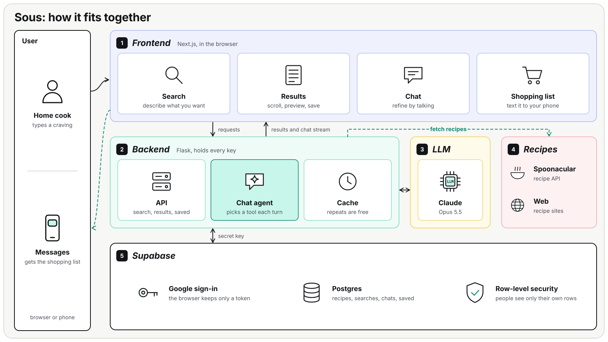

<a id="readme-top"></a>

<div align="center">
  <h1>
    &nbsp;Sous
  </h1>

  <p>
    Describe what you're craving, get a list of recipes, and refine it by chatting.
    <br />
    <a href="https://github.com/hanyjasmine/sous-svc"><strong>See the backend »</strong></a>
    <br />
    <br />
    <a href="https://github.com/hanyjasmine/sous-chef/issues/new?labels=bug">Report Bug</a>
    &middot;
    <a href="https://github.com/hanyjasmine/sous-chef/issues/new?labels=enhancement">Request Feature</a>
  </p>
</div>

<details>
  <summary>Table of Contents</summary>
  <ol>
    <li>
      <a href="#about-the-project">About The Project</a>
      <ul>
        <li><a href="#architecture">Architecture</a></li>
        <li><a href="#built-with">Built With</a></li>
      </ul>
    </li>
    <li>
      <a href="#getting-started">Getting Started</a>
      <ul>
        <li><a href="#prerequisites">Prerequisites</a></li>
        <li><a href="#installation">Installation</a></li>
      </ul>
    </li>
    <li><a href="#usage">Usage</a></li>
    <li><a href="#project-structure">Project Structure</a></li>
    <li><a href="#roadmap">Roadmap</a></li>
    <li><a href="#license">License</a></li>
    <li><a href="#contact">Contact</a></li>
    <li><a href="#acknowledgments">Acknowledgments</a></li>
  </ol>
</details>

## About The Project

Sous is a recipe finder you talk to. Type something like "cozy vegetarian dinner under 30 minutes" and you get a scrollable list of recipes, with a chat beside it to narrow things down ("no mushrooms", "only the soups") or change direction entirely.

- **Natural-language search.** No filters to fill in. Claude turns the sentence into diets, allergies, time limits and ingredients.
- **Chat that edits the list.** The assistant narrows the current results when it can, and runs a fresh search when you change your mind.
- **More than one source.** Recipes come from Spoonacular, and when that comes back thin, from recipe sites across the web.
- **Save recipes** with Google sign-in.
- **Shopping list.** Uncheck what you already have, then text the list to yourself, share it, or copy it.

This repo is the Next.js frontend. All Claude calls, recipe fetching and database writes happen in [sous-svc](https://github.com/hanyjasmine/sous-svc), the Flask backend.

<p align="right">(<a href="#readme-top">back to top</a>)</p>

### Architecture

<picture>
  <source media="(prefers-color-scheme: dark)" srcset="docs/images/architecture-dark.svg">
  
</picture>

<!-- - The browser only talks to this app. Calls to `/api/svc/*` are rewritten to sous-svc, so there's no CORS and the backend address stays private.
- The browser holds only the Supabase publishable key and the signed-in user's token. Every secret key lives in the backend.
- The shopping list is built in the browser and handed to the phone's own Messages app through an `sms:` link, so no SMS provider is involved. -->

More diagrams (search pipeline, chat tool loop, database schema) are in the [backend README](https://github.com/hanyjasmine/sous-svc#architecture).

<p align="right">(<a href="#readme-top">back to top</a>)</p>

### Built With

* [![Next][Next.js]][Next-url]
* [![React][React.js]][React-url]
* [![TypeScript][TypeScript]][TypeScript-url]
* [![Tailwind][Tailwind]][Tailwind-url]
* [![Supabase][Supabase]][Supabase-url]
* [![i18next][i18next]][i18next-url]

<p align="right">(<a href="#readme-top">back to top</a>)</p>

## Getting Started

### Prerequisites

* Node.js 20 or newer
* pnpm
  ```sh
  npm install -g pnpm
  ```
* [sous-svc](https://github.com/hanyjasmine/sous-svc) running locally on port 5001
* A Supabase project with Google sign-in turned on

### Installation

1. Clone the repo
   ```sh
   git clone https://github.com/hanyjasmine/sous-chef.git
   cd sous-chef
   ```
2. Install packages
   ```sh
   pnpm install
   ```
3. Create `.env.local` from the example and fill in your Supabase project URL and publishable key
   ```sh
   cp .env.example .env.local
   ```
   ```sh
   SOUS_SVC_URL=http://127.0.0.1:5001
   NEXT_PUBLIC_SUPABASE_URL=
   NEXT_PUBLIC_SUPABASE_PUBLISHABLE_KEY=
   ```
4. Start the dev server
   ```sh
   pnpm dev
   ```
5. Open [http://localhost:3000](http://localhost:3000)

<p align="right">(<a href="#readme-top">back to top</a>)</p>

## Usage

1. **Search.** Describe what you want on the landing page, or pick one of the suggestions.
2. **Browse.** Tap a result to preview its ingredients, or open the full recipe. More results load as you scroll. When Sous is pulling recipes from the web, they appear in the list as they're found.
3. **Chat.** Ask for changes in plain words: "something quicker", "no dairy", "which ones use chickpeas?". The list updates as the assistant replies.
4. **Save.** Sign in with Google and tap the bookmark on any recipe. Saved recipes live on the Saved page.
5. **Shop.** Open a recipe's shopping list, uncheck what you already have, then **Text it**, **Share** or **Copy**.

<p align="right">(<a href="#readme-top">back to top</a>)</p>

## Project Structure

```
src/
├── app/            routes: landing, /search/[sessionId], /saved, auth callback
├── views/          page-level views (LandingView, SearchView, SavedView)
├── components/
│   ├── landing/    search bar, suggestions
│   ├── results/    result list, recipe card, preview, fullscreen, shopping list
│   ├── chat/       chat panel, bubbles, input
│   ├── auth/       sign-in dialog and provider
│   ├── navigation/ nav bar
│   └── ui/         shared primitives (Base UI + Tailwind)
├── hooks/          useChat, useAuth, useSavedRecipes
├── lib/            sous-svc client, Supabase clients, shopping list helpers
├── locales/        UI strings (en.json)
└── types/          shared TypeScript types
```

<p align="right">(<a href="#readme-top">back to top</a>)</p>

## Roadmap

- [x] Natural-language search with Google sign-in
- [x] Result list with previews, fullscreen view and infinite scroll
- [x] Chat that narrows results or runs a new search
- [x] Web recipes when the recipe API comes back thin
- [x] Saved recipes
- [x] Shopping list you can text, share or copy
- [ ] Combined shopping list across several saved recipes
- [ ] SMS sending through Twilio
- [ ] NYT Cooking as another recipe source

See the [open issues](https://github.com/hanyjasmine/sous-chef/issues) for more.

<p align="right">(<a href="#readme-top">back to top</a>)</p>

<!-- ## License

No license has been chosen yet, so all rights are reserved for now.

<p align="right">(<a href="#readme-top">back to top</a>)</p>

## Contact

hanyjasmine - [@hanyjasmine](https://github.com/hanyjasmine)

Frontend: [https://github.com/hanyjasmine/sous-chef](https://github.com/hanyjasmine/sous-chef)
<br />
Backend: [https://github.com/hanyjasmine/sous-svc](https://github.com/hanyjasmine/sous-svc)

<p align="right">(<a href="#readme-top">back to top</a>)</p> -->

<!-- ## Acknowledgments

* [Spoonacular](https://spoonacular.com/food-api) for recipe data
* [Claude](https://www.anthropic.com/claude) for search parsing, chat and web recipe finding
* [Supabase](https://supabase.com) for auth and Postgres
* [shadcn/ui](https://ui.shadcn.com) and [Base UI](https://base-ui.com) for UI primitives
* [Lucide](https://lucide.dev) for icons
* [Best-README-Template](https://github.com/othneildrew/Best-README-Template) for this README's layout

<p align="right">(<a href="#readme-top">back to top</a>)</p> -->

<!-- MARKDOWN LINKS & IMAGES -->
[Next.js]: https://img.shields.io/badge/next.js-000000?style=for-the-badge&logo=nextdotjs&logoColor=white
[Next-url]: https://nextjs.org/
[React.js]: https://img.shields.io/badge/React-20232A?style=for-the-badge&logo=react&logoColor=61DAFB
[React-url]: https://react.dev/
[TypeScript]: https://img.shields.io/badge/TypeScript-3178C6?style=for-the-badge&logo=typescript&logoColor=white
[TypeScript-url]: https://www.typescriptlang.org/
[Tailwind]: https://img.shields.io/badge/Tailwind_CSS-0F172A?style=for-the-badge&logo=tailwindcss&logoColor=38BDF8
[Tailwind-url]: https://tailwindcss.com/
[Supabase]: https://img.shields.io/badge/Supabase-1C1C1C?style=for-the-badge&logo=supabase&logoColor=3ECF8E
[Supabase-url]: https://supabase.com/
[i18next]: https://img.shields.io/badge/i18next-26A69A?style=for-the-badge&logo=i18next&logoColor=white
[i18next-url]: https://www.i18next.com/
